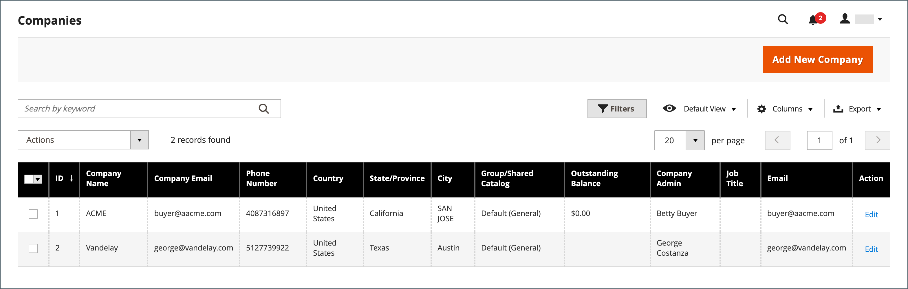
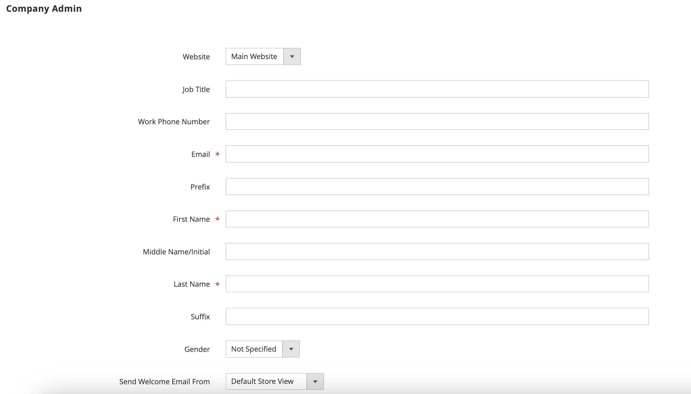

# Assegnare un amministratore società

L’amministratore della società viene inizialmente assegnato al momento della creazione dell’account aziendale e può essere modificato solo da un amministratore dello store dell’amministratore.

- A ogni società può essere assegnato un solo amministratore.
- Un utente della società può essere l’amministratore di una sola società.
- Le modifiche all’amministratore della società assegnato devono essere completate da un amministratore del negozio dell’amministratore.

## Modifica amministratore società assegnato

1. Nella barra laterale _Admin_, passa a **[!UICONTROL Customers]** > **[!UICONTROL Companies]**.

   {width="700" zoomable="yes"}

1. Trovare la società nell&#39;elenco e quindi fare clic su **[!UICONTROL Edit]**.

1. Espandere  nella sezione **[!UICONTROL Company Admin]**.

   {width="700" zoomable="yes"}

1. Immettere **[!UICONTROL Job Title]** del nuovo amministratore società.

   Questa azione cancella il modulo e i campi obbligatori _[!UICONTROL First Name]_&#x200B;e_[!UICONTROL Last Name]_ sono evidenziati.

1. Immettere l&#39;indirizzo **[!UICONTROL Email]** del nuovo amministratore della società.

   Se il sistema non trova l&#39;indirizzo e-mail nel database, viene richiesto di confermare la sostituzione dell&#39;amministratore della società.

   - Se non esiste un account utente per il nuovo amministratore della società, il sistema crea un account di tipo `Company Admin`.

   - Se l&#39;account utente esiste nel sistema, viene spostato nella posizione di amministratore della società nella struttura della società.

1. Immettere **[!UICONTROL First Name]** e **[!UICONTROL Last Name]** ed eventuali altre informazioni applicabili per il nuovo amministratore della società.

1. Al termine, fare clic su **[!UICONTROL Save]**.

   L’account individuale dell’amministratore della società precedente rimane nel sistema come account utente attivo, assegnato al ruolo utente predefinito. Se si tratta dell&#39;unica società associata all&#39;account utente, il tipo di account cambia da *[!UICONTROL Company user]* a *[!UICONTROL Individual user]*.

   Il sistema invia una notifica e-mail della modifica agli amministratori della nuova e della società precedente.

