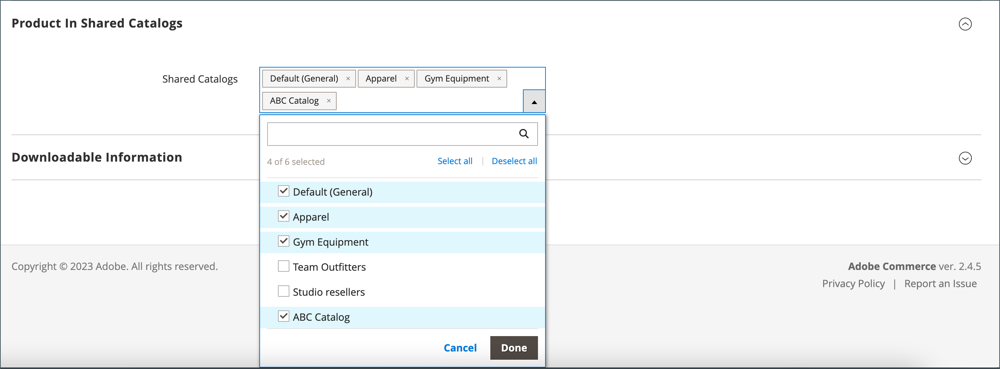
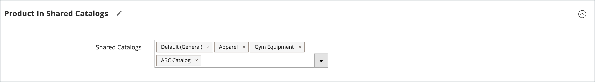

# Aggiungere prodotti a un catalogo condiviso

I prodotti possono essere aggiunti a un catalogo condiviso singolarmente o in gruppi di più prodotti per categoria.

Affinché un prodotto complesso (ad esempio bundle, raggruppato o configurabile) sia visibile dalla vetrina in un catalogo condiviso, è necessario che siano soddisfatti i seguenti requisiti:

- Tutti i [prodotti associati](../catalog/product-configurations.md) e le opzioni devono essere assegnati allo stesso catalogo condiviso e abilitati nel catalogo principale.
- Per i prodotti [configurable](../catalog/product-create-configurable.md) e [grouped](../catalog/product-create-grouped.md), sono visibili solo i prodotti associati abilitati.
- Per un prodotto [bundle](../catalog/product-create-bundle.md), tutte le opzioni devono essere incluse nel catalogo condiviso.

  {width="600" zoomable="yes"}

## Metodo 1: Aggiungere un singolo prodotto

1. Nella barra laterale _Admin_, passa a **[!UICONTROL Catalog]** > **[!UICONTROL Products]**.

1. Per il prodotto nella griglia da aggiungere, passare alla colonna _[!UICONTROL Action]_e fare clic su **[!UICONTROL Edit]**.

1. Scorri verso il basso, espandi  nella sezione _[!UICONTROL Product in Shared Catalogs]_ed effettua le seguenti operazioni:

   - Seleziona la casella di controllo di ciascun catalogo condiviso in cui deve essere visualizzato il prodotto. Per scegliere tutti i cataloghi, fare clic su **[!UICONTROL Select all]**.

     {width="600" zoomable="yes"}

     Il nome di ogni catalogo selezionato viene visualizzato nel campo _[!UICONTROL Shared Catalogs]_.

     {width="600" zoomable="yes"}

   - Fare clic su **[!UICONTROL Done]** per salvare le impostazioni.

1. Al termine, fare clic su **[!UICONTROL Save]**.

## Metodo 2: Aggiungere più prodotti

1. Nella barra laterale _Admin_, passa a **[!UICONTROL Catalog]** > **[!UICONTROL Shared Catalogs]**.

1. Per il catalogo condiviso nella griglia, passare alla colonna _[!UICONTROL Action]_e selezionare **[!UICONTROL Set Pricing and Structure]**.

1. Nell&#39;albero delle categorie eseguire una delle operazioni seguenti:

   - Per includere tutti i prodotti, fare clic su **[!UICONTROL Select all]** o selezionare la casella di controllo della categoria padre.
   - Per includere categorie specifiche di prodotti, seleziona la casella di controllo di ciascuna categoria che desideri includere.
   - Per includere o escludere un singolo prodotto, seleziona o deseleziona la casella di controllo del prodotto.

   La notazione sotto ogni categoria nella struttura mostra il numero di prodotti della categoria attualmente inclusi nel catalogo condiviso. La notazione sotto la [categoria principale](../catalog/category-root.md) mostra il numero totale di prodotti di tutte le categorie attualmente selezionate per il catalogo condiviso.

1. Per visualizzare i prodotti di categoria nella griglia, fare clic sul nome della categoria nella struttura.

   Quando si seleziona una categoria, si verifica quanto segue:

   - L&#39;interruttore nella prima colonna della griglia è impostato su `On` per ciascun prodotto selezionato.
   - Se un prodotto viene assegnato a più categorie e viene omesso in una di esse, rimane disponibile tramite le altre categorie e tramite [ricerca nel catalogo](../catalog/search.md).
   - Il sistema imposta automaticamente [Autorizzazioni categoria](../catalog/category-permissions.md) su `Allow` per i prodotti selezionati.
