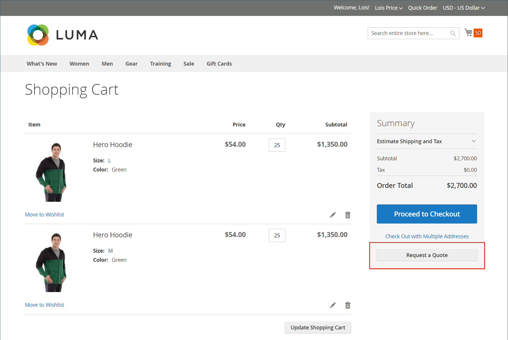

# Richiesta di offerta

Se i preventivi sono abilitati nella [configurazione delle funzionalità di vendita](configure-quotes.md), un acquirente autorizzato di una società può avviare il processo di negoziazione del prezzo richiedendo un preventivo dal carrello. Se un buyer non è pronto a sottomettere un preventivo per la negoziazione, può salvarlo come bozza.

>[!NOTE]
>
>Una richiesta di preventivo non può includere codici sconto o gift card.

## Esperienza di richiesta di preventivo del cliente

1. Il cliente accede al proprio account utente come acquirente con [autorizzazione](account-company-roles-permissions.md) per richiedere un preventivo.

1. Aggiunge al carrello i prodotti da includere nell&#39;offerta.

   >[!TIP]
   > 
   >I clienti possono aggiungere più rapidamente un elenco di SKU di prodotto al carrello utilizzando [Ordine rapido](quick-order.md).

1. Seleziona **[!UICONTROL Request a Quote]**.

   {width="700" zoomable="yes"}

1. Nella casella **[!UICONTROL Add your comment]**, il cliente immette una breve nota per descrivere la richiesta.

1. Immette un **[!UICONTROL Quote Name]**.

   {width="400" zoomable="yes"}

1. Se necessario, allega un documento o un&#39;immagine di supporto all&#39;offerta:

   - Seleziona **[!UICONTROL Attach file]**.
   - Seleziona il file dal proprio sistema.

   Per impostazione predefinita, un [file allegato](configure-quotes.md) può avere una dimensione massima di 2 MB, in uno qualsiasi dei seguenti formati di file: DOC, DOCX, XLS, XLSX, PDF, TXT, JPG o JPEG, PNG.

1. Crea ed elabora il preventivo:

   - Invia il preventivo al venditore selezionando **[!UICONTROL Request a Quote]**.
   - Salva il preventivo come bozza selezionando **[!UICONTROL Save as Draft]**.

     Se l&#39;acquirente salva il preventivo come bozza, il preventivo sarà disponibile in [!UICONTROL My Quotes] nello stato `Draft`. Le proposte di preventivo non sono visibili al venditore finché l&#39;acquirente non le invia per la revisione.
