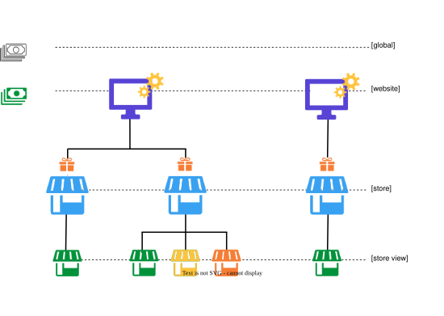
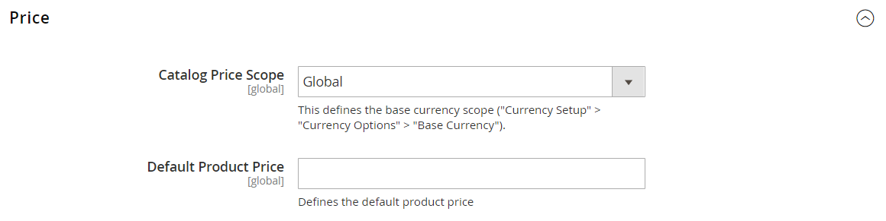

# Limite di prezzo

L&#39;ambito della [valuta di base](../stores-purchase/currency-configuration.md) utilizzata per i prezzi dei prodotti può essere configurato per essere applicato a livello globale o a livello di sito Web. Se applicato al livello globale, lo stesso prezzo viene utilizzato in tutta la gerarchia del punto vendita. Se applicato a livello di sito web, lo stesso prodotto può essere disponibile a prezzi diversi da negozi associati a siti web diversi. Per impostazione predefinita, la determinazione dei prezzi del prodotto è globale.

Fattori diversi possono influenzare il prezzo dello stesso prodotto in un luogo e non in un altro. Ad esempio, potrebbero esserci costi di distribuzione aggiuntivi per il prodotto e altre considerazioni che influiscono sul prezzo dei prodotti venduti in un negozio specifico. Il diagramma seguente mostra un&#39;installazione multisito con la valuta di base impostata a livello di sito Web. I negozi e le viste negozio associati a ciascun sito web riflettono i prezzi del prodotto impostati a livello di sito web.

 Se utilizzi cataloghi condivisi, consulta anche [Impostare i prezzi e la struttura del catalogo condiviso](../b2b/catalog-shared-pricing-structure.md) nella _Guida di Adobe Commerce B2B_.

{width="550"}

## Configura ambito prezzo

1. Nel menu _Amministratore_, vai a **[!UICONTROL Stores]** > _[!UICONTROL Settings]_>**[!UICONTROL Configuration]**.

1. Nel pannello a sinistra, espandi **[!UICONTROL Catalog]** e scegli **[!UICONTROL Catalog]** sotto.

1. Scorri verso il basso fino alla sezione **[!UICONTROL Price]** e imposta **[!UICONTROL Catalog Price Scope]** su uno dei seguenti elementi:

   - `Global`
   - `Website`

   L&#39;impostazione dell&#39;ambito scelta viene visualizzata sotto i campi prezzo del catalogo.

   {width="600" zoomable="yes"}

1. Al termine, fare clic su **[!UICONTROL Save Config]**.

## Utilizza ambito per impostare i prezzi dei prodotti

Commerce non consente di impostare un prezzo di prodotto per ogni negozio. Ma puoi cambiare il prezzo per sito:

1. Nel menu _Amministratore_, vai a **[!UICONTROL Stores]** > _[!UICONTROL Settings]_>**[!UICONTROL Configuration]**.

1. Nel pannello a sinistra, espandi **[!UICONTROL Catalog]** e scegli **[!UICONTROL Catalog]** sotto.

1. Nella scheda **[!UICONTROL Price]**, impostare l&#39;ambito prezzo su `Website` invece di `Global`.

1. Per impostare il prezzo, aprire la pagina di modifica del prodotto, selezionare l&#39;ambito in alto a sinistra, quindi immettere un nuovo prezzo per sito Web.

In rari casi, quando l&#39;ambito del prezzo è impostato su `Global`, il database di Commerce può ancora avere prezzi diversi a livello di sito Web. Ciò può verificarsi a causa di problemi di sincronizzazione al di fuori di Commerce. In questi casi, il commerciante deve eseguire una pulizia dei prezzi a livello di negozio ed eseguire una sincronizzazione catalogo con Commerce Services.