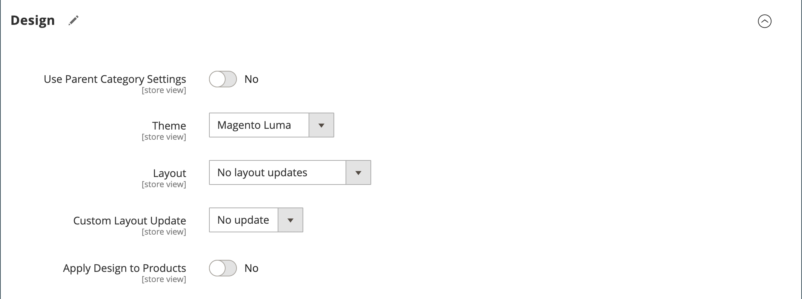

# Categorie - Impostazioni di progettazione

La sezione _[!UICONTROL Design]_consente di controllare l&#39;aspetto di una categoria, tutte le pagine di prodotto associate e il layout di pagina. È possibile personalizzare una pagina categoria e i relativi prodotti associati per una promozione o per differenziare la categoria. Ad esempio, puoi sviluppare un design distintivo per un marchio o una linea di prodotti speciale, oppure applicare un aggiornamento per un periodo di tempo specifico.

{width="600" zoomable="yes"}

>[!NOTE]
>
>Quando lo stesso prodotto viene assegnato a più categorie con impostazioni di progettazione diverse per ciascuna categoria, si consiglia di impostare **Usa percorso categorie per URL prodotto** = `Yes` nelle [opzioni di configurazione Ottimizzazione motore di ricerca](../configuration-reference/catalog/catalog.md#search-engine-optimization). Per accedere a questa impostazione, vai a **[!UICONTROL Stores]** > _[!UICONTROL Settings]_>**[!UICONTROL Configuration]**, espandi **[!UICONTROL Catalog]**e scegli **Catalogo**sotto nel pannello a sinistra, quindi espandi la sezione **Ottimizzazione motore di ricerca**nella pagina.

| Campo | Descrizione |
|--- |--- |
| [!UICONTROL Use Parent Category Settings] | Consente alla categoria corrente di ereditare le impostazioni di progettazione dalla categoria padre. Se utilizzati, tutti gli altri campi della sezione Progettazione diventano non disponibili. Opzioni: `Yes` / ` No` |
| [!UICONTROL Theme] | Applica un tema personalizzato alla categoria. |
| [!UICONTROL Layout] | Applica un layout diverso alla pagina della categoria. Opzioni:  **[!UICONTROL No layout updates]**- Per impostazione predefinita, gli aggiornamenti del layout non sono disponibili per le pagine delle categorie. **[!UICONTROL Empty]** - Consente di definire il layout di pagina. (Richiede la comprensione di XML)  **[!UICONTROL 1 column]**- Applica un layout a una colonna alla pagina della categoria. **[!UICONTROL 2 columns with left bar]** - Applica un layout a due colonne con barra laterale a sinistra alla pagina della categoria.  **[!UICONTROL 2 columns with right bar]**- Applica un layout a due colonne con una barra laterale a destra alla pagina della categoria. **[!UICONTROL 3 columns]** - Applica un layout a tre colonne alla pagina della categoria. **[!UICONTROL Page -- Full Width]**- (Richiede [Page Builder](../page-builder/introduction.md)) Applica il layout a larghezza intera per le pagine CMS alla pagina della categoria. **[!UICONTROL Category -- Full Width]** - (Richiede Page Builder) Applica il layout a larghezza intera per le pagine delle categorie alla pagina delle categorie.  **[!UICONTROL Product -- Full Width]**- (Richiede Page Builder) Applica il layout a larghezza intera per le pagine dei prodotti alla pagina della categoria. |
| [!UICONTROL Custom Layout Update] | Elenca i file di aggiornamento del layout personalizzato disponibili sul server. Scegliere l&#39;aggiornamento del layout personalizzato da applicare alla categoria. |
| [!UICONTROL Apply Design to Products] | Se questa opzione è selezionata, applica le impostazioni personalizzate a tutti i prodotti della categoria. |

{style="table-layout:auto"}

## [!UICONTROL Scheduled Design Update]

{{ce-feature}}

La sezione _[!UICONTROL Scheduled Design Update]_determina l&#39;intervallo di date in cui viene applicata una struttura personalizzata alle pagine delle categorie.

| Campo | Descrizione |
|--- |--- |
| [!UICONTROL Schedule Update From/To] | Determina l’intervallo di date in cui viene applicato un layout personalizzato alla categoria. |

{width="600" zoomable="yes"}
