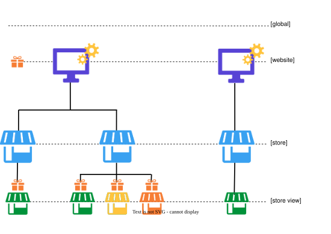
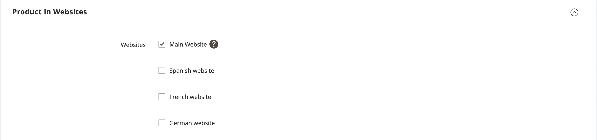

# Impostazioni prodotto - [!UICONTROL Product in Websites]

La sezione _[!UICONTROL Product in Websites]_&#x200B;identifica ogni sito Web in cui il prodotto è disponibile, in base alla [gerarchia di store](../stores-purchase/stores.md).

{width="550"}

**_Per copiare un prodotto in un altro sito Web:_**

1. Apri il prodotto in modalità di modifica.

1. Scorri verso il basso ed espandi il  nella sezione _[!UICONTROL Product in Websites]_.

   {width="600" zoomable="yes"}

1. Seleziona la casella di controllo del sito web in cui desideri inserire il prodotto copiato.

   Per l&#39;installazione di un singolo sito Web, la casella di controllo del sito Web è selezionata per impostazione predefinita.

1. Scegliere **[!UICONTROL Store View]** dove si desidera creare una copia del prodotto esistente.

1. Fare clic su **[!UICONTROL Save]** ed effettuare le seguenti operazioni:

   - Quando si torna al record del prodotto, impostare il selettore **[!UICONTROL Store View]** sulla visualizzazione dello store in cui è stato copiato il prodotto. Quando viene richiesto di confermare il cambio di ambito, fare clic su **[!UICONTROL OK]**.

   - Immettere **[!UICONTROL Price]** del prodotto per la visualizzazione dello store.

   Poiché l&#39;ambito della valuta di base è impostato su `website`, è possibile vendere il prodotto a un prezzo diverso in ogni sito Web.

1. Al termine, fare clic su **[!UICONTROL Save]**.

