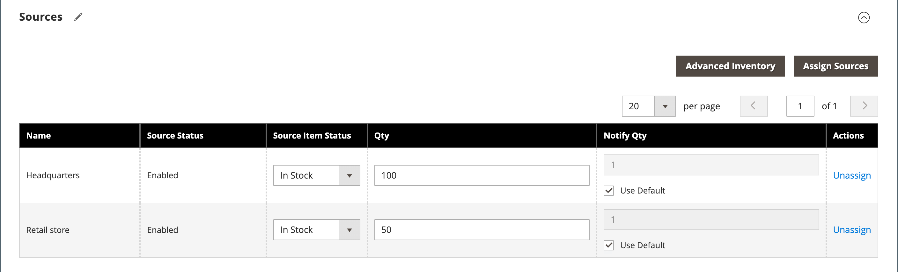

# Impostazioni prodotto - [!UICONTROL Sources]

Nella sezione _[!UICONTROL Sources]_delle impostazioni del prodotto sono elencate le origini da cui è possibile distribuire il prodotto. Viene utilizzato per assegnare e annullare l’assegnazione delle origini e per gestire la quantità e la disponibilità del prodotto. Questa sezione viene visualizzata solo se per lo store sono definite più origini. Per ulteriori informazioni sulle origini, vedere [Gestione origini](../inventory-management/sources-manage.md).

## Assegnare un&#39;origine per un prodotto

1. Fare clic su **[!UICONTROL Assign Source]**.

1. Selezionare la casella di controllo per le origini richieste.

1. Fare clic su **[!UICONTROL Done]**.

1. Selezionare **[!UICONTROL Source Item Status]** e immettere i valori **[!UICONTROL Qty]** e **[!UICONTROL Notify Qty]** in base alle esigenze.

1. Fare clic su **[!UICONTROL Save]** per salvare le modifiche.

{width="600" zoomable="yes"}

## Riferimento campo

| Campo | Descrizione |
|--- |--- |
| [!UICONTROL Name] | Nome univoco di un&#39;origine. |
| [!UICONTROL Source Status] | Determina se il prodotto è abilitato o disabilitato nel catalogo. |
| [!UICONTROL Source Item Status] | Determina la disponibilità corrente del prodotto. Opzioni: **[!UICONTROL In Stock]**- Rende il prodotto disponibile per l&#39;acquisto. **[!UICONTROL Out of Stock]** - Se non vengono attivati gli ordini inevasi, impedisce che il prodotto sia disponibile per l&#39;acquisto e rimuove l&#39;inserzione dal catalogo. |
| [!UICONTROL Qty] | Quantità di scorte disponibili per ciascuna origine. |
| [!UICONTROL Notify Qty] | Importo per _Notify per Quantità_ per questa origine specifica se `Notify Quantity Use Default` non è selezionato. |
| [!UICONTROL Notify Qty Use Default] | Indica di utilizzare l&#39;impostazione predefinita per _Notify for Quantity_ nell&#39;impostazione del prodotto Advanced Inventory o globale nella configurazione dell&#39;archivio. Per ulteriori informazioni sulle impostazioni di inventario avanzate per il prodotto, vedere [Configurare le opzioni di prodotto avanzate](../inventory-management/product-options.md). |
| [!UICONTROL Actions] | Per un&#39;origine assegnata, fare clic su **[!UICONTROL Unassign]** per rendere l&#39;origine non disponibile per il prodotto. Per un&#39;origine non assegnata, fare clic su **[!UICONTROL Assign Sources]** per rendere disponibile un&#39;origine per il prodotto. Per ulteriori informazioni sulle opzioni [!UICONTROL Assign Sources], vedere [Assegnazione di origini per prodotto](../inventory-management/sources-assign-per-product.md). |

{style="table-layout:auto"}

