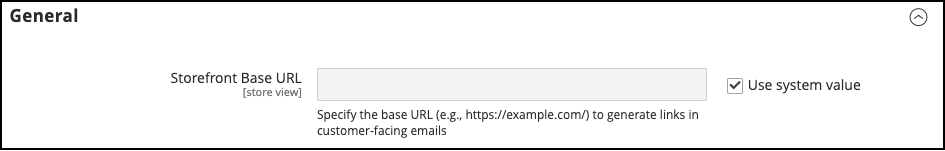
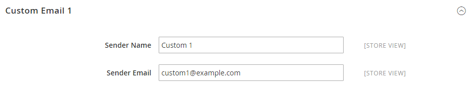

# [!UICONTROL General] > [!UICONTROL Store Email Addresses]

{{config}}

Per informazioni dettagliate su questi campi e opzioni di configurazione, vedi [Archivia indirizzi e-mail](../../getting-started/store-details.md#store-email-addresses).

## [!UICONTROL General]

[!BADGE Solo SaaS]{type=Positive url="https://experienceleague.adobe.com/en/docs/commerce/user-guides/product-solutions" tooltip="Applicabile solo ai progetti Adobe Commerce as a Cloud Service (infrastruttura SaaS gestita da Adobe)."}

<!-- zoom -->

| Campo | [Ambito](../../getting-started/websites-stores-views.md#scope-settings) | Descrizione |
|--- |--- |--- |
| [!UICONTROL Storefront Base URL] | Visualizzazione store | L’URL di base che verrà utilizzato per creare i collegamenti inclusi nelle e-mail rivolte al cliente. L’URL deve terminare con una barra. Ad esempio, `https://www.example.com/`. |

{style="table-layout:auto"}

## [!UICONTROL General Contact]

<!-- zoom -->

| Campo | [Ambito](../../getting-started/websites-stores-views.md#scope-settings) | Descrizione |
|--- |--- |--- |
| [!UICONTROL Sender Name] | Visualizzazione store | Il nome visualizzato come mittente dell&#39;e-mail inviata dall&#39;identità `General Contact`. |
| [!UICONTROL Sender Email] | Visualizzazione store | Indirizzo e-mail associato all&#39;identità `General Contact`. In Adobe Commerce as a Cloud Service, crea un ticket di supporto per modificare l’indirizzo e-mail. |

{style="table-layout:auto"}

## [!UICONTROL Sales Representative]

<!-- zoom -->

| Campo | [Ambito](../../getting-started/websites-stores-views.md#scope-settings) | Descrizione |
|--- |--- |--- |
| [!UICONTROL Sender Name] | Visualizzazione store | Il nome visualizzato come mittente dell&#39;e-mail inviata dall&#39;identità `Sales Representative`. |
| [!UICONTROL Sender Email] | Visualizzazione store | Indirizzo e-mail associato all&#39;identità `Sales Representative`.  In Adobe Commerce as a Cloud Service, crea un ticket di supporto per modificare l’indirizzo e-mail. |

{style="table-layout:auto"}

## [!UICONTROL Customer Support]

<!-- zoom -->

| Campo | [Ambito](../../getting-started/websites-stores-views.md#scope-settings) | Descrizione |
|--- |--- |--- |
| [!UICONTROL Sender Name] | Visualizzazione store | Il nome visualizzato come mittente dell&#39;e-mail inviata dall&#39;identità `Customer Support`. |
| [!UICONTROL Sender Email] | Visualizzazione store | Indirizzo e-mail associato all&#39;identità `Customer Support`.  In Adobe Commerce as a Cloud Service, crea un ticket di supporto per modificare l’indirizzo e-mail. |

{style="table-layout:auto"}

## E-mail personalizzata 1

<!-- zoom -->

| Campo | [Ambito](../../getting-started/websites-stores-views.md#scope-settings) | Descrizione |
|--- |--- |--- |
| [!UICONTROL Sender Name] | Visualizzazione store | Il nome visualizzato come mittente dell&#39;e-mail inviata dall&#39;identità `Custom 1`. |
| [!UICONTROL Sender Email] | Visualizzazione store | Indirizzo e-mail associato all&#39;identità `Custom 1`.  In Adobe Commerce as a Cloud Service, crea un ticket di supporto per modificare l’indirizzo e-mail. |

{style="table-layout:auto"}

## E-mail personalizzata 2

<!-- zoom -->

| Campo | [Ambito](../../getting-started/websites-stores-views.md#scope-settings) | Descrizione |
|--- |--- |--- |
| [!UICONTROL Sender Name] | Visualizzazione store | Il nome visualizzato come mittente dell&#39;e-mail inviata dall&#39;identità `Custom 2`. |
| [!UICONTROL Sender Email] | Visualizzazione store | Indirizzo e-mail associato all&#39;identità `Custom 2`.  In Adobe Commerce as a Cloud Service, crea un ticket di supporto per modificare l’indirizzo e-mail. |

{style="table-layout:auto"}
