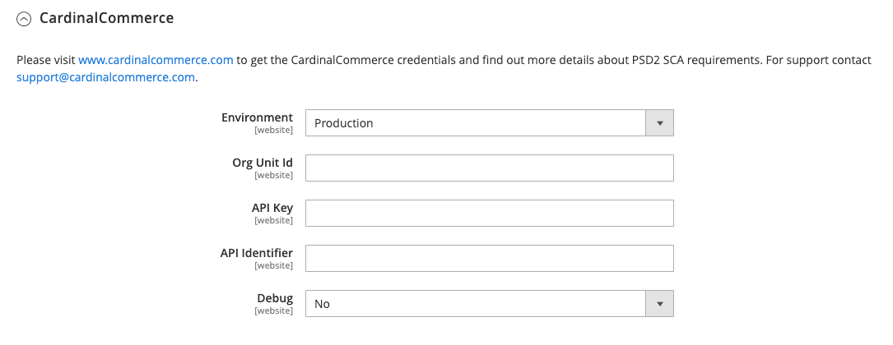

# [!UICONTROL Sales] > [!UICONTROL 3D Secure]

[!DNL 3-D Secure] è stato sviluppato da [!DNL Visa] per promuovere transazioni online sicure. Esempi di [!DNL 3-D Secure] soluzioni create da reti con schede sono verificate da [!DNL Visa], [!DNL Mastercard SecureCode], [!DNL American Express SafeKey] e [!DNL CardinalCommerce Consumer Authentication]. [!DNL CardinalCommerce] è un leader globale nell&#39;autenticazione delle transazioni digitali e una consociata interamente controllata da [!DNL Visa].

[!DNL 3-D Secure] versione 2.0 supporta numerosi miglioramenti, tra cui metodi di autenticazione e flusso di autenticazione avanzati e una migliore condivisione dei dati tra esercente ed emittente.

>[!NOTE]
>
>Il gateway di pagamento [Braintree](../../stores-purchase/braintree.md) supporta anche la verifica [!DNL 3-D Secure].

{{config}}

## [!UICONTROL CardinalCommerce]

<!-- zoom -->

| Campo | [Ambito](../../getting-started/websites-stores-views.md#scope-settings) | Descrizione |
|--- |--- |--- |
| [!UICONTROL Environment] | Sito Web | Indica la modalità operativa dell&#39;account [!DNL CardinalCommerce]. Se l’esecuzione avviene in un ambiente di test, scegli &quot;Sandbox&quot;. Opzioni: Sandbox / Produzione (predefinito) |
| [!UICONTROL Org Unit ID] | Sito Web | L&#39;ID dell&#39;unità organizzativa dall&#39;account esercente [!DNL CardinalCommerce]. |
| [!UICONTROL API Key] | Sito Web | La chiave API dal tuo account esercente [!DNL CardinalCommerce]. |
| [!UICONTROL API Identifier] | Sito Web | L&#39;identificatore API dell&#39;account esercente [!DNL CardinalCommerce]. |
| [!UICONTROL Debug] | Sito Web | Opzioni: `Yes` / `No` |

{style="table-layout:auto"}
