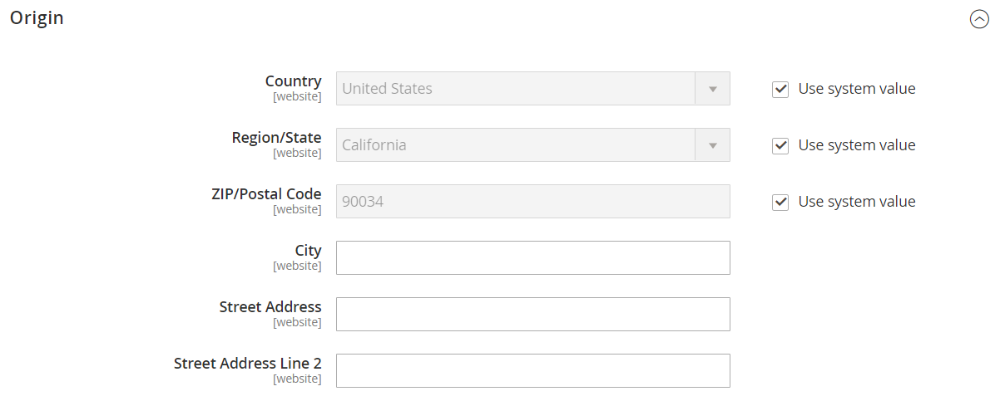
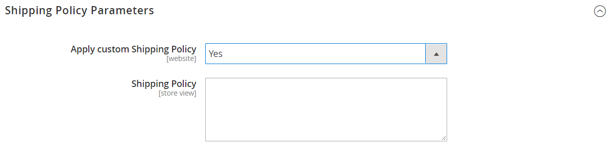
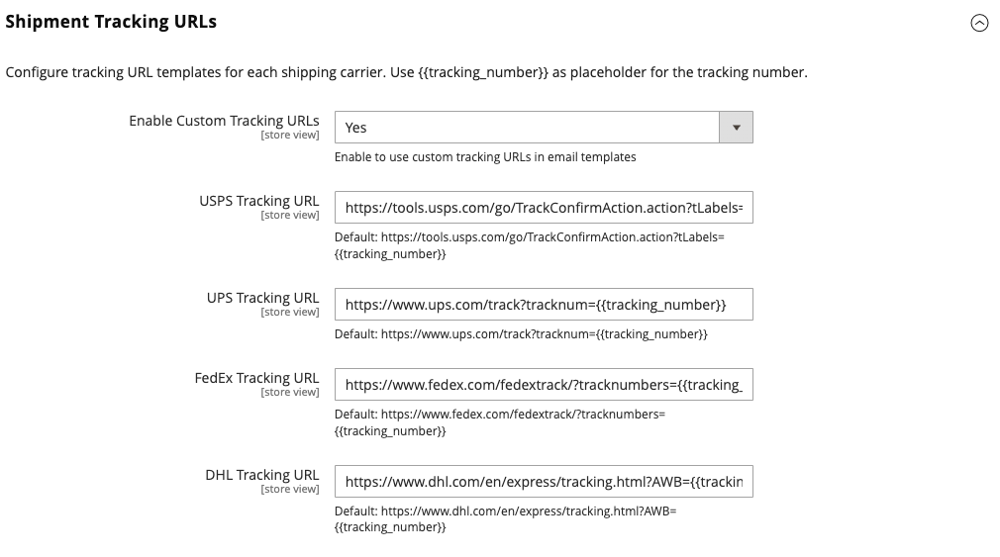

# [!UICONTROL Sales] > [!UICONTROL Shipping Settings]

{{config}}

Per ulteriori informazioni sulla modifica di queste impostazioni, vedere [Impostazioni di spedizione](../../stores-purchase/shipping-settings.md) nella _Guida agli store e all&#39;acquisto_.

## [!UICONTROL Origin]

<!-- zoom -->

| Campo | [Ambito](../../getting-started/websites-stores-views.md#scope-settings) | Descrizione |
|--- |--- |--- |
| [!UICONTROL Country] | Sito Web | Il paese del punto di origine. |
| [!UICONTROL Region/State] | Sito Web | Regione o stato del punto di origine. |
| [!UICONTROL ZIP/Postal Code] | Sito Web | Il codice postale o ZIP del punto di origine. |
| [!UICONTROL City] | Sito Web | La città del punto di origine. |
| [!UICONTROL Street Address] | Sito Web | Indirizzo del punto di origine. |
| [!UICONTROL Street Address Line 2] | Sito Web | Una riga aggiuntiva per l’indirizzo stradale del punto di origine, se necessario. |

{style="table-layout:auto"}

## [!UICONTROL Shipping Policy Parameters]

<!-- zoom -->

| Campo | [Ambito](../../getting-started/websites-stores-views.md#scope-settings) | Descrizione |
|--- |--- |--- |
| [!UICONTROL Apply Custom Shipping Policy] | Sito Web | Determina se la politica di spedizione viene visualizzata durante il pagamento. Opzioni: `Yes` / `No` |
| [!UICONTROL Shipping Policy] | Visualizzazione store | Contiene la politica di spedizione come testo. |

{style="table-layout:auto"}

## [!UICONTROL Shipment Tracking URLs]

[!BADGE Solo SaaS]{type=Positive url="https://experienceleague.adobe.com/it/docs/commerce/user-guides/product-solutions" tooltip="Applicabile solo ai progetti Adobe Commerce as a Cloud Service (infrastruttura SaaS gestita da Adobe)."}

<!-- zoom -->

| Campo | [Ambito](../../getting-started/websites-stores-views.md#scope-settings) | Descrizione |
|--- |--- |--- |
| [!UICONTROL Enable Custom Tracking URLs] | Visualizzazione store | Determina se i numeri di registrazione delle spedizioni inviati nelle e-mail dei clienti sono collegamenti o testo normale. Il valore predefinito `No` indica che i numeri sono testo normale. Opzioni: `Yes` / `No` |
| [!UICONTROL USPS Tracking URL] | Visualizzazione store | Il modello URL per le spedizioni del servizio postale degli Stati Uniti. |
| [!UICONTROL UPS Tracking URL] | Visualizzazione store | Modello URL per spedizioni United Parcel Service. |
| [!UICONTROL FedEx Tracking URL] | Visualizzazione store | Modello URL per spedizioni Federal Express. |
| [!UICONTROL DHL Tracking URL] | Visualizzazione store | Modello URL per spedizioni DHL Express. |

{style="table-layout:auto"}
