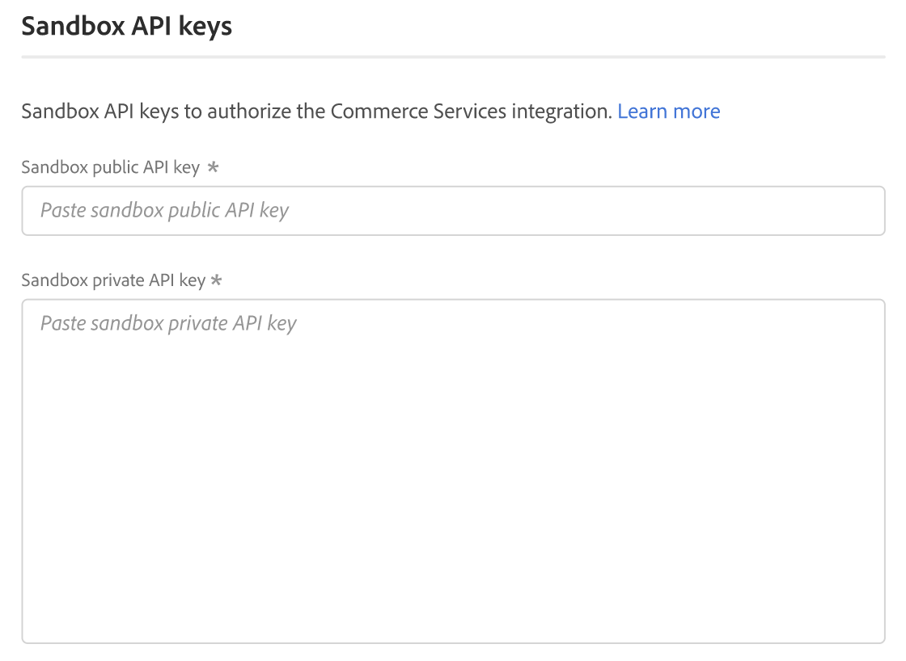
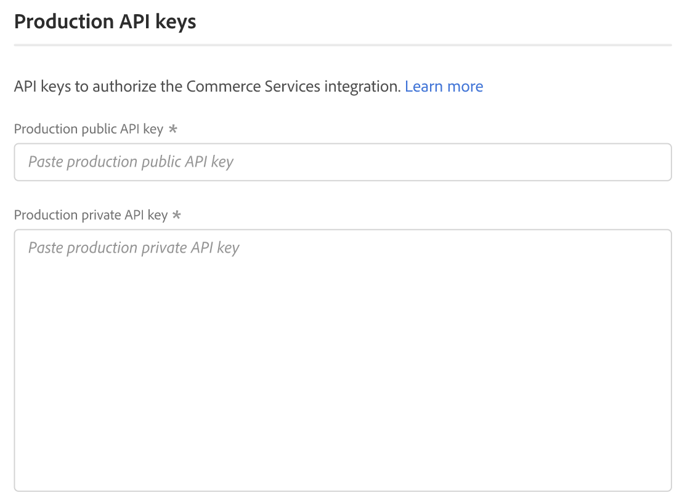
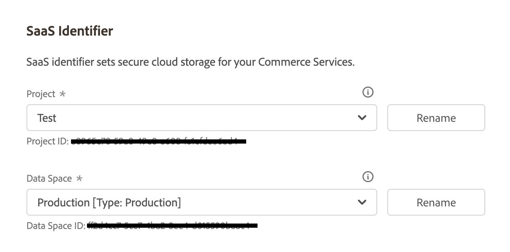
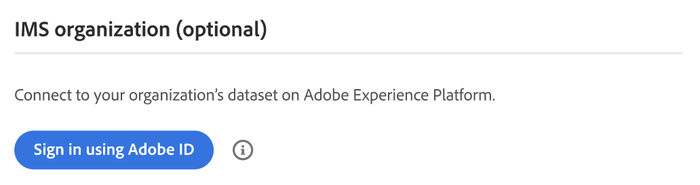

# [!UICONTROL Services] > [!UICONTROL Commerce Services Connector]

Per informazioni su come connettere il tuo archivio ai servizi Adobe Commerce, consulta [Servizi Commerce](https://experienceleague.adobe.com/en/docs/commerce/user-guides/integration-services/saas).

{{config}}

## [!UICONTROL Sandbox API Keys]

<!-- zoom -->

| Campo | [Ambito](../../getting-started/websites-stores-views.md#scope-settings) | Descrizione |
|--- |--- |--- |
| [!UICONTROL Sandbox public API key] | Globale | Chiave API che identifica l’autore e i relativi diritti, se presenti. |
| [!UICONTROL Sandbox private API key] | Globale | Una chiave privata associata alla chiave API. |

{style="table-layout:auto"}

## [!UICONTROL Production Keys]

<!-- zoom -->

| Campo | [Ambito](../../getting-started/websites-stores-views.md#scope-settings) | Descrizione |
|--- |--- |--- |
| [!UICONTROL Production public API key] | Globale | Chiave API che identifica l’autore e i relativi diritti, se presenti. |
| [!UICONTROL Production private API key] | Globale | Una chiave privata associata alla chiave API. |

{style="table-layout:auto"}

## [!UICONTROL SaaS Identifier]

<!-- zoom -->

| Campo | [Ambito](../../getting-started/websites-stores-views.md#scope-settings) | Descrizione |
|--- |--- |--- |
| [!UICONTROL Project] | Globale | Nome del progetto SaaS che raggruppa tutti gli spazi di dati SaaS. Se non esistono progetti SaaS, viene visualizzato il pulsante _Crea progetto_. |
| [!UICONTROL Data Space] | Globale | Elenca gli spazi di dati SaaS nel progetto SaaS specificato. Il numero di spazi dati SaaS dipende dalla [licenza Commerce](https://experienceleague.adobe.com/en/docs/commerce/user-guides/integration-services/saas): Adobe Commerce - Uno spazio dati di produzione; due spazi dati di test; Magento Open Source - Uno spazio dati di produzione; nessuno spazio dati di test |

{style="table-layout:auto"}

## [!UICONTROL IMS Organization]

<!-- zoom -->

| Campo | Descrizione |
|--- |--- |
| [!UICONTROL Sign in using Adobe ID] | Il tuo Adobe ID è in genere l’indirizzo e-mail utilizzato per la prima volta quando hai iniziato a iscriverti o acquistato un’applicazione o un servizio Adobe. Il tuo Adobe ID è la chiave di cui hai bisogno per accedere al tuo account Adobe. |

{style="table-layout:auto"}
