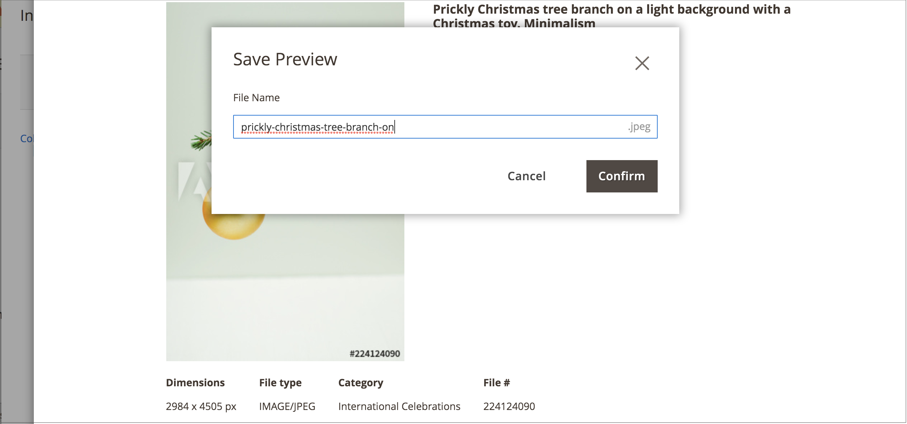

# Salvare un’anteprima dell’immagine Adobe Stock

L’anteprima dell’immagine è una versione con filigrana di una risorsa Adobe Stock. Le anteprime delle immagini sono gratuite e rappresentano un buon metodo per sperimentare diverse immagini prima di decidere di [acquistare una licenza](./adobe-stock-license-image.md) per immagini specifiche e utilizzarle negli archivi di produzione.

Quando si è pronti a concedere in licenza un&#39;immagine, il nuovo [[!DNL Media Gallery]](media-gallery.md) fornisce un&#39;integrazione diretta con Adobe Stock, semplificando la concessione in licenza dell&#39;immagine direttamente dalla pagina della galleria.

## Prerequisiti

Questa funzionalità richiede il modulo e la configurazione dell&#39;[Integrazione Adobe Stock](./adobe-stock.md).

## Salvare un&#39;immagine di anteprima

1. [Accedi alla griglia di ricerca di Adobe Stock](./adobe-stock-manage.md#access-the-adobe-stock-search-grid).

1. Per [visualizzare i dettagli immagine](./adobe-stock-manage.md#view-image-details), fare clic su un&#39;immagine nella griglia di ricerca.

1. Fare clic su **[!UICONTROL Save Preview]**.

   Questa azione richiede di specificare un nome di file utilizzato per salvare l&#39;immagine nell&#39;[archivio multimediale](./media-storage.md). Viene fornito un nome di file predefinito, ma puoi personalizzarlo in base alle tue preferenze.

   {width="500" zoomable="yes"}

1. Fare clic su **[!UICONTROL Confirm]**.

   La pagina viene reindirizzata all&#39;archivio multimediale e viene visualizzata l&#39;anteprima salvata.
