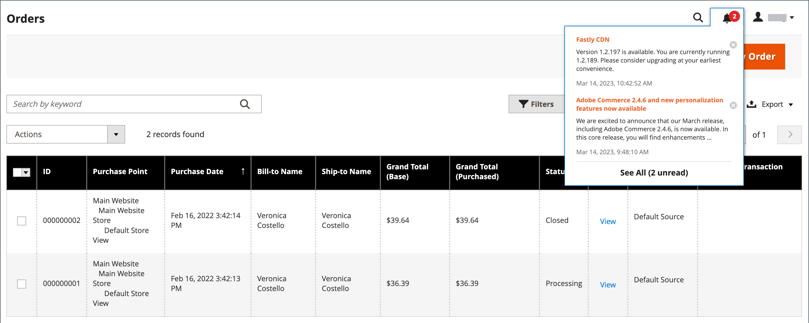
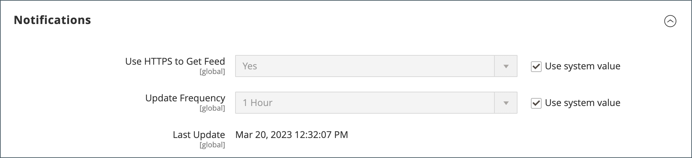

# Casella in entrata messaggio amministratore

>[!NOTE]
>
>Per notifiche, richieste e annunci di prodotti Adobe Commerce as a Cloud Service nella navigazione superiore di Adobe Unified Experience, consulta [Visualizza notifiche](admin-unified-experience.md#view-notifications). Questo argomento descrive la casella in entrata dei messaggi dell’amministratore di Commerce, non il pannello delle notifiche nell’interfaccia Unified Experience di Adobe.

Lo store riceve regolarmente messaggi da Adobe. I messaggi sono classificati in base alla loro importanza e possono fare riferimento ad aggiornamenti di sistema, patch, nuove versioni, manutenzione programmata o eventi futuri. L’icona a forma di campana nell’intestazione indica il numero di messaggi non letti nella casella in entrata.

{width="700" zoomable="yes"}

Nella pagina _[!UICONTROL Notifications]_sono elencati tutti i messaggi classificati per data. I comandi_[!UICONTROL Action]_ possono essere utilizzati per contrassegnare singoli messaggi come letti, visualizzare informazioni più dettagliate o rimuovere il messaggio dalla posta in arrivo.

La configurazione determina la frequenza di aggiornamento della casella in entrata e la modalità di consegna dei messaggi. Se l&#39;amministratore del tuo archivio dispone di un URL sicuro, le notifiche devono essere inviate tramite HTTPS.

## Visualizza nuovi messaggi in arrivo

1. Fai clic sull&#39;icona **[!UICONTROL Notification]** nell&#39;intestazione e leggi il riepilogo.

1. Effettuare una delle seguenti operazioni:

   - Se necessario, fai clic sul messaggio per visualizzare il testo completo.
   - Per eliminare il messaggio, fai clic sull’icona Elimina a destra del messaggio.
   - Per visualizzare l&#39;elenco completo delle notifiche, fare clic su **[!UICONTROL See All]**.

## Risolvere un messaggio critico

Per un messaggio di importanza critica, effettua una delle seguenti operazioni:

- Fare clic su **[!UICONTROL Read Details]**.
- Per chiudere la finestra di avviso mantenendo attivo il messaggio, fare clic su **[!UICONTROL Close]**.

## Amministrare le notifiche

1. Per aprire la pagina Notifiche, eseguire una delle operazioni seguenti:

   - Fai clic sull&#39;icona **[!UICONTROL Notification]** nell&#39;intestazione. Se sono presenti uno o più nuovi messaggi, fare clic su **[!UICONTROL See All]**.

   - Nella barra laterale _Admin_, passa a **[!UICONTROL System]** > _[!UICONTROL Other Settings]_>**[!UICONTROL Notifications]**.

1. Nella colonna **[!UICONTROL Action]** eseguire una delle operazioni seguenti:

   - Per ulteriori informazioni, fare clic su **[!UICONTROL Read Details]** per aprire la pagina collegata in una nuova finestra.

   - Per mantenere il messaggio nella Posta in arrivo, fare clic su **[!UICONTROL Mark As Read]**.

     {width="700" zoomable="yes"}

   - Per eliminare il messaggio, scegliere **[!UICONTROL Remove]**.

1. Per applicare un&#39;azione a più messaggi, eseguire una delle operazioni seguenti:

   - Seleziona la casella di controllo nella prima colonna per ogni messaggio da gestire.
   - Per selezionare più messaggi, impostare il controllo **[!UICONTROL Mass Actions]** in base alle esigenze.

1. Impostare il controllo **[!UICONTROL Actions]** su uno dei seguenti valori:

   - `Mark as Read`
   - `Remove`

1. Fare clic su **[!UICONTROL Submit]** per completare il processo.

## Configurare le notifiche

1. Nella barra laterale _Admin_, passa a **[!UICONTROL Stores]** > _[!UICONTROL Settings]_>**[!UICONTROL Configuration]**.

1. Nel pannello di navigazione a sinistra, espandi **[!UICONTROL Advanced]** e scegli **[!UICONTROL System]**.

1. Espandi la sezione **[!UICONTROL Notifications]**.

   {width="600"}

1. Se l&#39;amministratore dello store esegue un [URL protetto](../stores-purchase/store-urls.md), impostare **[!UICONTROL Use HTTPS to Get Feed]** su `Yes`.

1. Imposta **[!UICONTROL Update Frequency]** per determinare la frequenza con cui la tua casella in entrata viene aggiornata.

   L’intervallo può essere compreso tra una e 24 ore.

1. Al termine, fare clic su **[!UICONTROL Save Config]**.

Per ulteriori informazioni sulle opzioni di configurazione [!UICONTROL System], vedere la [_Guida di riferimento alla configurazione_](../configuration-reference/advanced/system.md).
