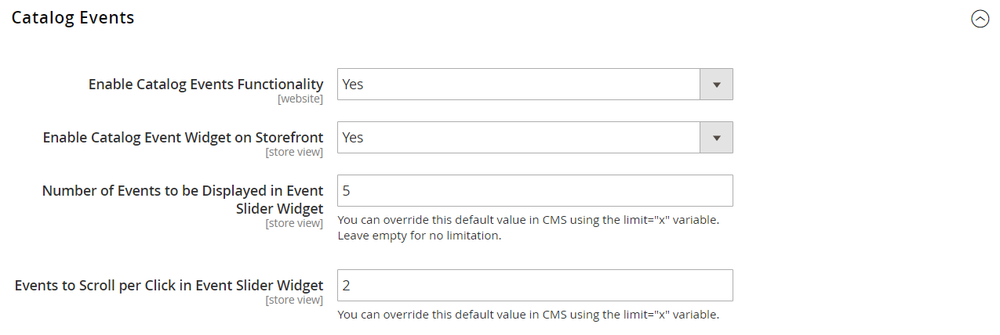
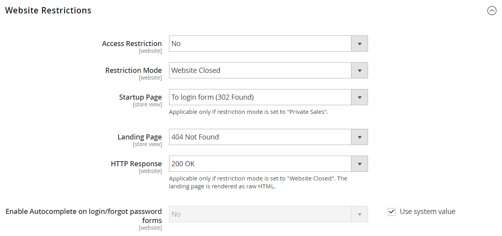

# Configurare gli eventi

{{ee-feature}}

Prima di poter creare un evento, devi completare la configurazione di base per abilitare gli eventi e impostare il blocco dell’evento nella barra laterale.

## Abilitare e configurare gli eventi

1. Nella barra laterale _Admin_, passa a **[!UICONTROL Stores]** > _[!UICONTROL Settings]_>**[!UICONTROL Configuration]**.

1. Nel pannello a sinistra, espandi **[!UICONTROL Catalog]** e scegli **[!UICONTROL Catalog]** sotto.

1. Espandere  nella sezione **[!UICONTROL Catalog Events]** ed effettuare le seguenti operazioni:

   {width="600" zoomable="yes"}

   - Imposta **[!UICONTROL Enable Catalog Events Functionality]** su `Yes`.

   - Imposta **[!UICONTROL Enable Catalog Event Widget on Storefront]** su `Yes`.

   - Immettere **[!UICONTROL Number of Events to be Displayed in the Event Slider Sidebar Widget]**. Per impostazione predefinita, questo valore è impostato su `5`. Se si desidera visualizzare un solo evento nel dispositivo di scorrimento alla volta, immettere `1`.

   - Immettere il numero di **[!UICONTROL Events to Scroll per Click in Event Slider Sidebar Widget]**. Per impostazione predefinita, questo valore è impostato su `2`. Se si desidera che il dispositivo di scorrimento visualizzi l&#39;evento successivo in sequenza al momento del clic, immettere `1`.

1. Al termine, fare clic su **[!UICONTROL Save Config]**.

## Limitazioni di accesso

L’accesso a una vendita, un evento o un sito privato può essere limitato ai clienti registrati che effettuano l’accesso o esteso ai clienti non registrati che devono registrarsi prima di ottenere l’accesso.

{width="600" zoomable="yes"}

### Limita l’accesso

L’accesso a una vendita, un evento o un sito privato può essere limitato ai clienti registrati che effettuano l’accesso o esteso ai clienti non registrati che devono registrarsi prima di ottenere l’accesso.

{width="600" zoomable="yes"}

1. Nella barra laterale _Admin_, passa a **[!UICONTROL Stores]** > _[!UICONTROL Settings]_>**[!UICONTROL Configuration]**.

1. Nel pannello a sinistra, espandi **[!UICONTROL General]** e scegli **[!UICONTROL General]** sotto.

1. Espandere  nella sezione **[!UICONTROL Website Restrictions]**.

1. Imposta **[!UICONTROL Access Restriction]** su `Yes`.

1. Imposta **[!UICONTROL Restriction Mode]** su uno dei seguenti:

   - `Website Closed`
   - `Private Sales: Login Only`
   - `Private Sales: Login and Register`

1. Imposta **[!UICONTROL Startup Page]** su uno dei seguenti:

   - `To login form (302 Found)` - Gli utenti vengono reindirizzati al modulo di accesso prima di accedere al sito.

   - `To landing page (302 Found)` - Gli utenti vengono reindirizzati alla pagina di destinazione specificata fino al loro accesso.

     >[!IMPORTANT]
     >
     >Assicurati di includere un collegamento alla pagina di accesso dalla pagina di destinazione, in modo che i clienti possano accedere al sito.

1. Scegli **[!UICONTROL Landing Page]** visualizzato prima che i clienti accedano al sito di vendita privato.

1. Per comunicare ai bot e ai spider dei motori di ricerca che la pagina di destinazione è corretta e che non sono presenti altre pagine da indicizzare, impostare **[!UICONTROL HTTP Response]** su `200 OK`.

   In tutti gli altri casi è impostato su `503 Service Unavailable`.

   >[!NOTE]
   >
   >Applicabile solo se la modalità di restrizione è impostata su _Sito Web chiuso_. Viene eseguito il rendering della pagina di destinazione come HTML non elaborato.

1. Se si desidera che i campi nei moduli di accesso cliente e password dimenticata vengano compilati automaticamente dalle voci precedenti, impostare **[!UICONTROL Enable Autocomplete on login/forgot password forms]** su `Yes`.

1. Al termine, fare clic su **[!UICONTROL Save Config]**.

### Limita vendite

Per impostazione predefinita, i prodotti visualizzati negli eventi in programma o chiusi non sono disponibili per la vendita generica e il pulsante _[!UICONTROL Add to Cart]_non viene visualizzato nell&#39;elenco dei prodotti o nella pagina dei prodotti.

Per ripristinare il pulsante _[!UICONTROL Add to Cart]_per un evento chiuso, è necessario eliminare l&#39;evento (vedere [Aggiornare gli eventi](event-create.md#update-events)). Tuttavia, se un prodotto è associato a un’altra categoria senza restrizioni di vendita, il pulsante è disponibile nella pagina del prodotto. Analogamente, il blocco ticker non viene visualizzato nella pagina del prodotto se il prodotto è associato a un’altra categoria senza restrizioni di vendita.
