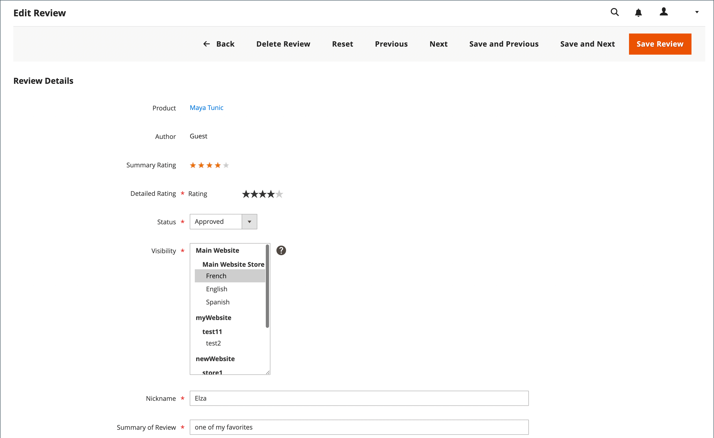

# Modera recensioni prodotto

Per le revisioni dei prodotti Commerce, prima di poter essere visualizzata, è necessario approvare una revisione del prodotto inviata. In questo modo le recensioni sono appropriate per visualizzare pubblicamente il tuo negozio. Lo stato di una revisione inviata è `Pending` finché non viene approvata o rifiutata.

## Visualizzare le recensioni dei prodotti in Admin

Per visualizzare tutte le recensioni per un prodotto specifico nell’Admin, effettua le seguenti operazioni:

1. Nella barra laterale _Admin_, passa a **[!UICONTROL Catalog]** > **[!UICONTROL Products]**.

1. Individuare il prodotto che si desidera visualizzare e fare clic su **[!UICONTROL Edit]** nella colonna _[!UICONTROL Action]_.

1. Nella pagina del prodotto, scorri verso il basso ed espandi il  nella sezione **[!UICONTROL Product Reviews]**.

   In questa griglia è inoltre possibile modificare la revisione specifica facendo clic sul collegamento **[!UICONTROL Edit]** nella colonna _[!UICONTROL Action]_.

## Aggiorna stato per le recensioni

1. Nella barra laterale _Admin_, vai a **[!UICONTROL Marketing]** > _[!UICONTROL User Content]_>**[!UICONTROL Pending Reviews]**o **[!UICONTROL All Reviews]**.

1. Nell’elenco, fai clic su una revisione in sospeso per visualizzare i dettagli e modificarli, se necessario.

1. Modifica **[!UICONTROL Status]** in base alla tua valutazione:

   - Per approvare una revisione in sospeso, selezionare `Approved`.

   - Per rifiutare una revisione, selezionare `Not Approved`. Le revisioni non approvate scompaiono dall&#39;elenco della pagina _[!UICONTROL Pending Reviews]_.

   >[!NOTE]
   >
   >Le recensioni con gli stati `Pending` e `Not Approved` non vengono visualizzate nella vetrina.

1. Se applicabile, imposta **[!UICONTROL Visibility]** di una recensione di prodotto per visualizzarla in diverse visualizzazioni dello store.

1. Se necessario, modificare i valori per **[!UICONTROL Detailed Rating]**, **[!UICONTROL Nickname]** e **[!UICONTROL Summary of Review]**.

   Per modificare la visualizzazione archivio in cui è disponibile una revisione, scegliere la visualizzazione archivio necessaria nella colonna _[!UICONTROL Visibility]_.

   {width="600" zoomable="yes"}

1. Al termine, fare clic su **[!UICONTROL Save Review]**.

## Aggiornamento batch

Puoi aggiornare o eliminare più recensioni contemporaneamente:

1. Nella barra laterale _Admin_, passa a **[!UICONTROL Marketing]** > _[!UICONTROL User Content]_>**[!UICONTROL All Reviews]**.

1. Seleziona le recensioni da aggiornare.

1. Utilizza il selettore _[!UICONTROL Action]_in alto a sinistra per applicare un&#39;azione.

1. Fai clic su **[!UICONTROL Submit]**

## Eliminare una recensione di prodotto

1. Nella barra laterale _Admin_, passa a **[!UICONTROL Marketing]** > _[!UICONTROL User Content]_>**[!UICONTROL All Reviews]**.

1. Trova la recensione del prodotto da eliminare e aprila in modalità di modifica.

1. Nella barra dei menu fare clic sul pulsante **[!UICONTROL Delete Review]**.

1. Per confermare l&#39;azione, fare clic su **[!UICONTROL OK]**.

## Barra dei pulsanti

| Pulsante | Descrizione |
|----------|--------------|
| **[!UICONTROL Back]** | Torna alla pagina Recensioni senza salvare le modifiche |
| **[!UICONTROL Delete Review]** | Elimina la revisione |
| **[!UICONTROL Reset]** | Ripristina i valori precedenti delle modifiche non salvate nel modulo di revisione |
| **[!UICONTROL Previous]** | Apre la revisione precedente |
| **[!UICONTROL Next]** | Apre la revisione successiva |
| **[!UICONTROL Save and Previous]** | Salva le modifiche correnti e apre la revisione precedente. Questo pulsante viene visualizzato se sono presenti altre recensioni. |
| **[!UICONTROL Save and Next]** | Salva le modifiche correnti e apre la visualizzazione successiva. Questo pulsante viene visualizzato se sono presenti altre recensioni. |
| **[!UICONTROL Save Review]** | Salva le modifiche e chiude la pagina di modifica della revisione |
