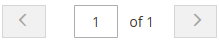

# Visual Merchandiser

{{ee-feature}}

_Visual Merchandiser_ è un set di strumenti avanzati che consente di posizionare i prodotti e applicare condizioni che determinano quali prodotti vengono visualizzati nell&#39;elenco delle categorie. Il risultato può essere una selezione dinamica di prodotti che si adatta alle modifiche nel catalogo. È possibile lavorare in _modalità visiva_, che mostra ogni prodotto come una sezione su una griglia, oppure lavorare da un elenco di prodotti della categoria. Gli stessi strumenti sono disponibili in ogni modalità e puoi utilizzare i pulsanti nell’angolo superiore destro per passare da un tipo di visualizzazione all’altro.

{width="600" zoomable="yes"}

## Accedere a Visual Merchandiser

1. Nella barra laterale _Admin_, passa a **[!UICONTROL Catalog]** > **[!UICONTROL Categories]**.

1. Espandere la struttura delle categorie e fare clic sulla categoria da modificare.

1. Scorri verso il basso ed espandi il  nella sezione **[!UICONTROL Products in Category]**.

1. Fai clic sul pulsante _Visualizza come riquadri_ (  ) per visualizzare i prodotti come griglia.

1. Al termine, fare clic su **[!UICONTROL Save Category]**.

## Modificare la posizione di un prodotto

1. Utilizza l&#39;[ordinamento](../catalog/navigation-product-listings.md) per visualizzare il prodotto che desideri spostare.

   - **Metodo 1: trascinamento**

     Acquisisci il controllo _Trascina_ () nell&#39;angolo superiore destro del riquadro del prodotto e rilascia il prodotto nella posizione desiderata. Il numero di ciascun prodotto viene regolato in base alla nuova posizione.

   - **Metodo 2: Imposta valore posizione**

     Nel controller _Position_ () del riquadro del prodotto, immettere il numero in cui si desidera visualizzare il prodotto. Immetti `0` per posizionare il prodotto all&#39;inizio dell&#39;elenco.

1. Al termine, fare clic su **[!UICONTROL Save Category]**.

>[!NOTE]
>
>In un&#39;installazione pulita, Adobe Commerce riserva l&#39;ID di categoria `2` per il catalogo principale dell&#39;archivio predefinito. In Visual Merchandiser è possibile utilizzare solo categorie con un numero di ID pari a `3` o superiore.

## Controlli Workspace

| Controllo | Descrizione |
|--- |--- |
|  | Visualizza come elenco |
|  | Visualizza come sezioni |
|  | Corrispondenza per regola - no |
|  | Corrispondenza per regola - sì |
|  | Trascina |
|  | Posizione |
|  | Rimuovi dalla categoria |
|  | Visualizza per pagina |
|  | Vai a successivo/precedente |

{style="table-layout:auto"}
