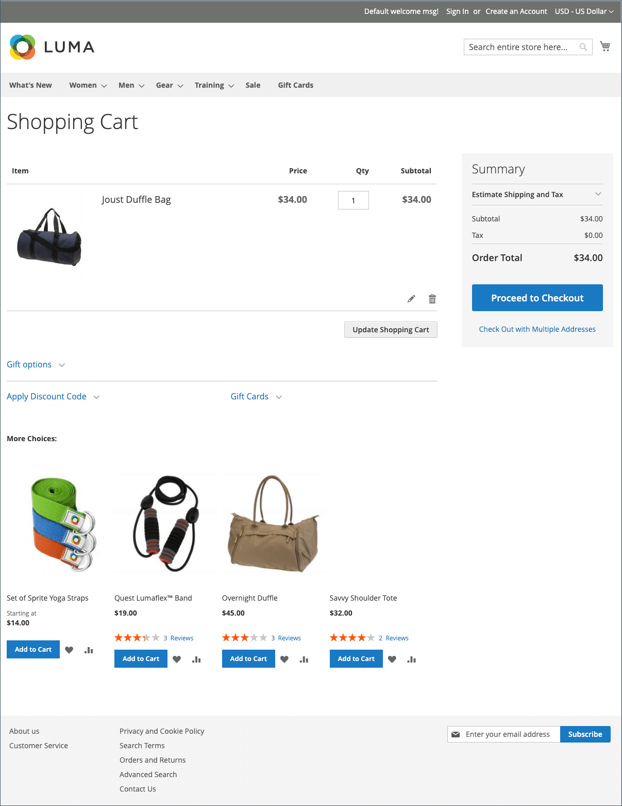

# Carrello

Il carrello è posizionato alla fine del percorso di acquisto, all&#39;intersezione di _Buy_ e _Abandon_, ed è una delle pagine più importanti del tuo negozio. Il carrello è il luogo in cui viene calcolato il totale dell’ordine, insieme a buoni sconto e spese di spedizione e imposte stimate. È un ottimo posto per mostrare i tuoi distintivi di fiducia e sigilli, e un&#39;opportunità ideale per offrire un ultimo elemento. Puoi scegliere gli articoli da offrire come acquisto di impulso di cross-selling ogni volta che un articolo specifico appare nel carrello.

{width="700" zoomable="yes"}

- Configura le [opzioni carrello](cart-configuration.md) per determinare quali strumenti sono disponibili per gli acquirenti e modifica la visualizzazione.
- Configura il comportamento [persistenza carrello](cart-persistent.md) per aiutare gli acquirenti a conservare il contenuto del carrello.
- Aggiungi il widget [Ordina per SKU](order-by-sku.md) per comodità di tutti gli acquirenti o solo di quelli appartenenti a gruppi di clienti specifici, per inserire le informazioni relative allo SKU e alla quantità direttamente in una pagina.
