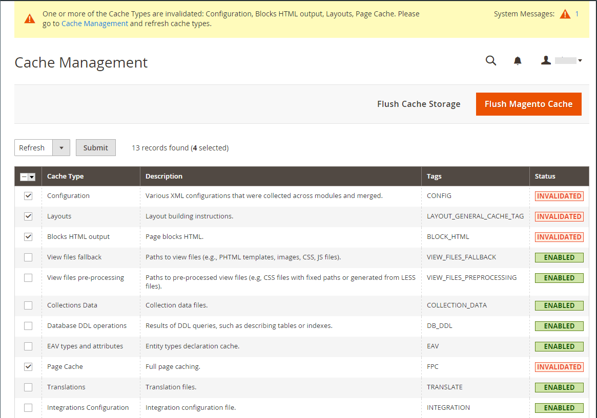

# Aggiorna tassi di cambio

I tassi di cambio possono essere impostati manualmente o importati nello store. Per fare in modo che il tuo negozio abbia i tassi più attuali, puoi configurare i tassi di valuta per essere aggiornati automaticamente secondo programma.

Prima di importare i tassi di valuta, completare l&#39;[impostazione dei tassi di valuta](currency-configuration.md) per specificare le valute accettate e stabilire la connessione e la pianificazione dell&#39;importazione.

{width="600" zoomable="yes"}

## Aggiornare manualmente un tasso di valuta

1. Nella barra laterale _Admin_, passa a **[!UICONTROL Stores]** > _[!UICONTROL Currency]_>**[!UICONTROL Currency Rates]**.

1. Fare clic sul tasso che si desidera modificare e immettere il nuovo valore per ogni valuta supportata.

1. Al termine, fare clic su **[!UICONTROL Save Currency Rates]**.

## Importa tassi di valuta

1. Nella barra laterale _Admin_, passa a **[!UICONTROL Stores]** > _[!UICONTROL Currency]_>**[!UICONTROL Currency Rates]**.

1. Impostare **[!UICONTROL Import Service]** sul provider del tasso di valuta.

   Il provider predefinito è `fixer.io (legacy)`.

   >[!IMPORTANT]
   >
   >A partire dalla versione 2.4.6, il servizio [[!DNL Fixer.io]](https://fixer.io/) è obsoleto e sostituito con il servizio [[!DNL Fixer API] (APILayer)](https://apilayer.com/marketplace/fixer-api). Si consiglia di utilizzare un account APILayer invece di un account [!DNL Fixer.io] obsoleto.

1. Fare clic su **[!UICONTROL Import]**.

   I tassi aggiornati vengono visualizzati nell&#39;elenco _[!UICONTROL Currency Rates]_. Se i tassi sono cambiati dopo l’ultimo aggiornamento, il vecchio tasso viene visualizzato di seguito come riferimento.

1. Al termine, fare clic su **[!UICONTROL Save Currency Rates]**.

1. Quando viene richiesto di aggiornare la cache, fare clic sul collegamento **[!UICONTROL Cache Management]** e aggiornare la cache non valida.

   {width="600" zoomable="yes"}

## Importa tassi di valuta secondo programma

1. Verifica che [Cron](../systems/cron.md) sia abilitato per il tuo archivio.

1. Per specificare le valute accettate e stabilire la connessione e la pianificazione per l&#39;importazione, completare l&#39;[Impostazione tasso valuta](currency-configuration.md).

1. Per verificare che le tariffe siano state importate nei tempi previsti, controllare l&#39;elenco _[!UICONTROL Currency Rates]_.

1. Attendere il periodo di tempo dell&#39;impostazione della frequenza stabilita per la pianificazione e controllare nuovamente le tariffe.
