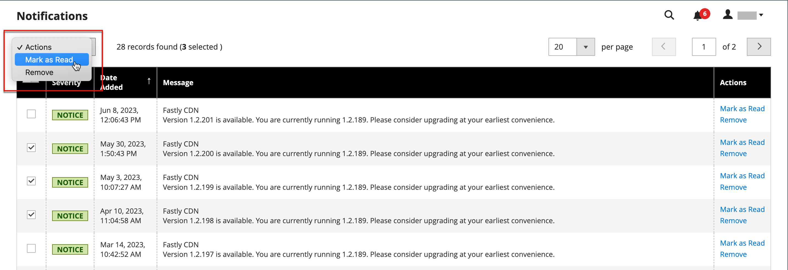

# Notifiche di sistema

Nella pagina _Notifiche_ sono elencati tutti i messaggi classificati in base alla gravità, con il più recente in alto. I comandi Azione possono essere utilizzati per contrassegnare i singoli messaggi come letti, visualizzare informazioni più dettagliate o rimuovere il messaggio dalla casella in entrata.

1. Per aprire la pagina _[!UICONTROL Notifications]_, eseguire una delle operazioni seguenti:

   - Fai clic sull&#39;icona _Notifica_ nell&#39;intestazione. Se sono presenti uno o più nuovi messaggi, fare clic su **[!UICONTROL See All]**.

   - Nella barra laterale _Admin_, passa a **[!UICONTROL System]** > _[!UICONTROL Other Settings]_>**[!UICONTROL Notifications]**.

1. Nella colonna **[!UICONTROL Action]** eseguire una delle operazioni seguenti:

   - Per ulteriori informazioni, fare clic su **[!UICONTROL Read Details]** per aprire la pagina collegata in una nuova finestra.

   - Per mantenere il messaggio nella Posta in arrivo, fare clic su **[!UICONTROL Mark As Read]**.

     {width="700" zoomable="yes"}

   - Per eliminare il messaggio, scegliere **[!UICONTROL Remove]**.

1. Per applicare un&#39;azione a più messaggi, eseguire una delle operazioni seguenti:

   - Seleziona la casella di controllo nella prima colonna per ogni messaggio da gestire.
   - Per selezionare più messaggi, impostare il controllo **[!UICONTROL Mass Actions]** in base alle esigenze.

1. Impostare il controllo **[!UICONTROL Actions]** su uno dei seguenti valori:

   - `Mark as Read`
   - `Remove`

1. Fare clic su **[!UICONTROL Submit]** per completare il processo.
