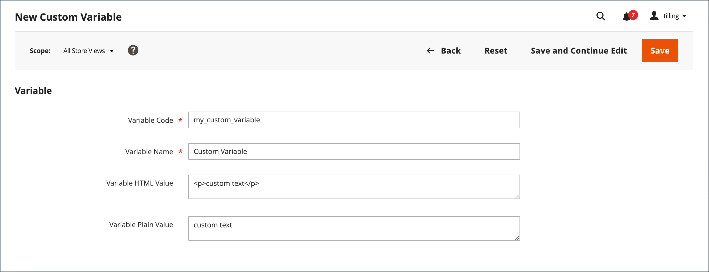
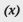

# Aggiungere variabili personalizzate

Per soddisfare le esigenze specifiche della tua azienda, puoi creare variabili personalizzate e inserirle in [pagine](../content-design/pages.md), [blocchi](../content-design/blocks.md) e [modelli e-mail](email-templates.md). L&#39;elenco delle variabili consentite visualizzato quando si fa clic sul pulsante _Inserisci variabile_ include sia [variabili predefinite](variables-predefined.md) che variabili personalizzate. L’elenco delle variabili disponibili per un modello e-mail specifico è determinato dai dati associati al modello. Per un elenco dei modelli e-mail utilizzati di frequente e delle relative variabili associate, vedere [Riferimento variabile](variables-reference.md).

{width="600" zoomable="yes"}

>[!NOTE]
>
>Nei modelli per e-mail e newsletter è possibile utilizzare solo le variabili predefinite o personalizzate consentite.

## Passaggio 1: creare una variabile personalizzata

1. Nella barra laterale _Admin_, passa a **[!UICONTROL System]** > _[!UICONTROL Other Settings]_>**[!UICONTROL Custom Variables]**.

1. Fare clic su **[!UICONTROL Add New Variable]**.

1. Immettere un identificatore per **[!UICONTROL Variable Code]**, utilizzando tutti i caratteri minuscoli senza spazi.

   Se necessario, è possibile utilizzare un carattere di sottolineatura o un trattino per rappresentare uno spazio. Esempio: `my_custom_variable`

1. Immettere **[!UICONTROL Variable Name]**, utilizzato come riferimento interno. Esempio: `My Custom Variable`

1. Per immettere il valore associato alla variabile, eseguire una delle operazioni seguenti:

   - Per **[!UICONTROL Variable HTML Value]**, immettere il valore della variabile formattato con semplici tag HTML. Ad esempio:

     `<b>This formatted content appears in place of the variable.</b>`

   - Per **[!UICONTROL Variable Plain Value]**, immettere il valore della variabile come testo normale senza formattazione. Ad esempio:

     `This unformatted content appears in place of the variable.`

   >[!TIP]
   >
   >Se è necessario più spazio, trascinare l&#39;angolo inferiore destro della casella di testo.

   {width="600" zoomable="yes"}

1. Al termine, fare clic su **[!UICONTROL Save]**.

## Passaggio 2: inserire la variabile personalizzata nel contenuto

Utilizzare [!DNL Page Builder] per inserire una variabile personalizzata.

1. Apri la pagina, il blocco, la categoria o il prodotto in cui desideri aggiungere la variabile al contenuto.

1. Espandere  nella sezione **[!UICONTROL Content]**.

1. Fare clic su **[!UICONTROL Edit with Page Builder]**.

1. Nel pannello a sinistra, fare clic su **[!UICONTROL Elements]** ed eseguire una delle operazioni seguenti:

   - Fare clic in un&#39;area di testo esistente in cui si desidera inserire la variabile.

   - Trascinare un nuovo oggetto **[!UICONTROL Text]** nell&#39;area di visualizzazione.

1. All&#39;estrema destra della barra degli strumenti dell&#39;editor, fare clic su (  ) per inserire una variabile.

   ![[!DNL Page Builder] area di visualizzazione e pannello](./assets/variable-custom-pagebuilder-stage.png){width="600" zoomable="yes"}

1. Nell&#39;elenco selezionare la variabile personalizzata che si desidera inserire e fare clic su **[!UICONTROL Insert Variable]**.

   {width="600" zoomable="yes"}

   L’identificatore della variabile viene visualizzato come segnaposto nell’editor.

   Fase ![[!DNL Page Builder] - segnaposto variabile](./assets/pagebuilder-variable-inserted.png){width="600" zoomable="yes"}

1. Al termine, fare clic su **[!UICONTROL Save]**.
